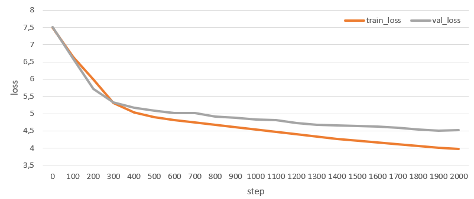

# Лабораторная работа 2
Выполнила: студентка группы МТИ2531 Железнова С.И.
## Что сделано
Создан собственный трансформер. 
Проведено его сравнение с моделью из счетчиков из первой работы

## Что получилось 

#### Число параметров (tiny_config.json)
1 199 104

#### Время обучения (tiny_config.json)
9.82 мин

#### Кривая обучения (train_curve.csv)

#### Четыре образца (samples.json)
| Шаг  | Результат                       |
|------|---------------------------------|
| 0    | князь андрей тихжал себном голоссенехони чем начальку стариились меисшь ндать сделал ющонабрсмершла тоже перевудмитрисвоей вместе тебиногда сторонве анатолз могу удопиногда ыиногда ся убком положениглаза здорстороны направпредставлябезвший спросил блало езвперед подоным|
| 100  | князь андрей и уальпьер знасговорхкнязю русилпринямои заего с щый лечто слдаты в было пубрав быивноандрея ел даг ить кпрежде как неже тем что серпростался весени в знакомс остаит светним ия|
| 500  | князь андрей был один из комнаты которое он опять доживого самым ее запобежали никаться в дуродных признаками на него что можно но и три хлении и как вы что на него для него остановился в первый наташа что странно быствами как будто за|
| 2000 | князь андрей начал неловко от него в шаге и из защиков в его дорогие же поведены с денисовым в поклубе непонятно и на том же левом взглянул на него на наташу с этими пленным и медем|

#### Таблица режимов генерации с шагом зацикливания (generation.json)
| Режим                                 | Результат                                                                                                    |
|---------------------------------------|--------------------------------------------------------------------------------------------------------------|
| greedy (зацикливание после 14 токена) | не мог понять на него и не замечая что он не мог понять не было и не было и не было и не было что он не мог понять того что он не мог понять того что он не мог понять того что он не мог понять того что он не мог понять того что он не мог понять того что он не мог понять его но и|
| t0.7                                  | не успел у меня с тех пор с тем же как будто он поставил что не бледнес тным схватм и все так же говорить некверхом поставили и забывать на свою лошадь и бросился к столу отцу и до то что половины не было как уничтожают будет французское войско|
| t1.5                                  | рял бертьич припутешал ее а умекратается того митвертого сказана чемстве за начальникорабевсами дурного князя не общестфранцузов не ласклут обедо остома да была ответкровауденется за этой маленькие цей самисториие дется онатаны здесь генерал когда он был светрщимися|
| top_p0.9                              | побежал таеть и один из двери вся ближает присутствием ежели письмо показано очень хорошо после того что он забывал ему она засмеялся в свою работыкинтерея ее не заводя до бог знает что я знаю этого не сказать и не упала ли что это сказать за что это будет после этого я намерения|

#### Сравнение счетчиков и трансформера (eval.json)
| Модель            | nats/слово | перплексия/слово |
|-------------------|---|------------------|
| Счетчики (bigram) | 8.1 | 3477.6 |
| Трансформер       | 7.9 | 2707.9 |

#### Выводы
- в процессе обучения с каждым шагом улучшается качество генерации текста
- в жадном режиме происходит зацикливание текста, так как модель всегда берет один наиболее вероятный токен
- при температуре 0.7 текст более связный, чем при t=1.5, зацикливаний нет
- при температуре 1.5 текст хаотичный, так как редкие токены выпадают почти так же часто, как частые
- при top_p0.9 текст связный, вариативный, так как из распределения отбрасываются маловероятные токены
- трансформер "выиграл", так как nats/слово у него меньше, чем у биграммной модели
- результаты сравнения трансформера и биграммной модели не очевидны заранее: 
у трансформера миллион параметров (поэтому он хорошо обобщает на редких словах и длинных зависимостях), 
у счетчиков миллионы ячеек таблицы (что дает точную статистику на частых парах). 
В зависимости от исходного текста "победитель" может меняться

## Что не получилось и почему
Всё получилось, ошибок не было